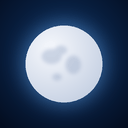
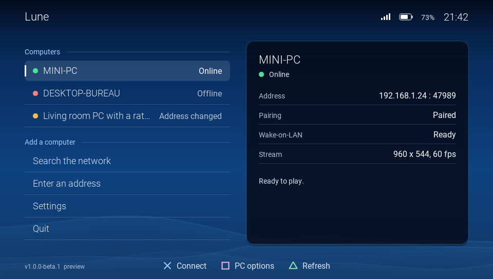
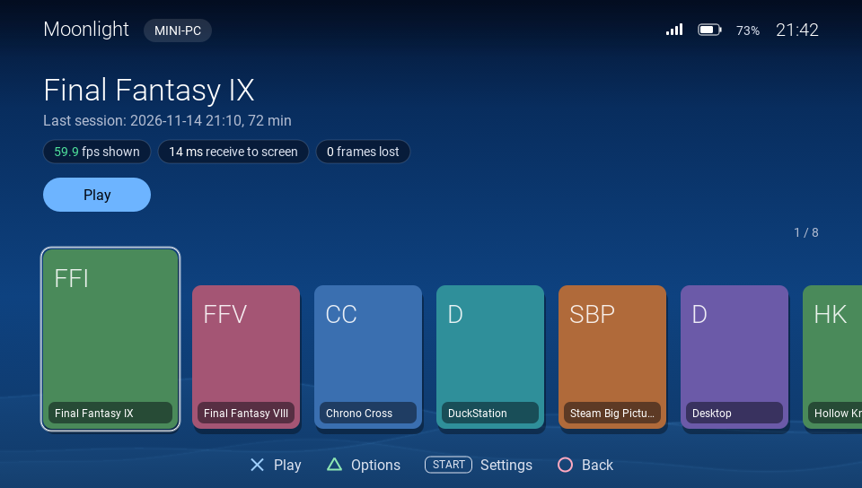
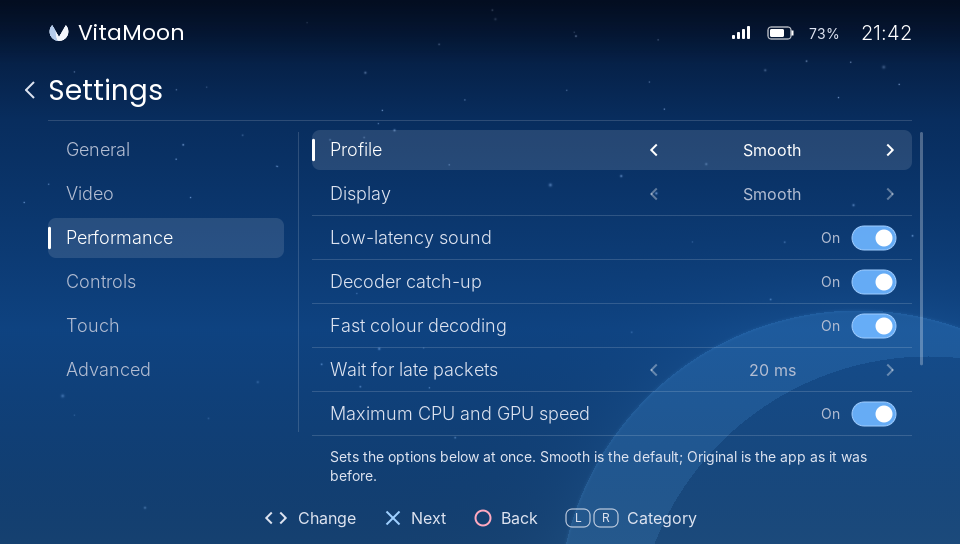
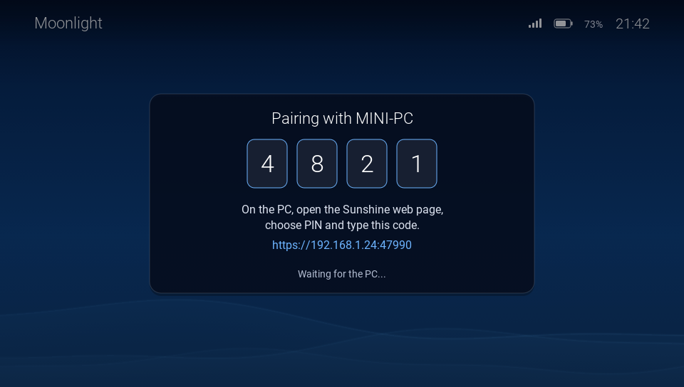

<div align="center">
  

  # Lune

  **Stream your PC games to a PlayStation Vita, built for a smooth picture over Wi-Fi**

  [](LICENSE)
  [](../../actions)
  [](CHANGELOG.md)
</div>

---

Lune is a [Moonlight](https://moonlight-stream.org) client for the PS Vita and PS TV: it plays the
games of a PC running [Sunshine](https://github.com/LizardByte/Sunshine) (or NVIDIA GameStream) on the
Vita, on your home network. *Lune* is French for moon.

It started from [xyzz/vita-moonlight](https://github.com/xyzz/vita-moonlight) 0.13.2 and reworks the
streaming path (decoding off the network thread, three display modes, adaptive audio, waiting for
late Wi-Fi packets), the interface, and the tools to measure what the Vita actually does. What was
taken from other forks, and what was measured by whom, is listed in
[docs/design/performance.md](docs/design/performance.md).

> **Status: beta.** Everything builds, the menus are checked on a PC in three languages and the
> stream logic is covered by PC tests, but this version has not yet been measured on a Vita. See
> [the checkpoint report](docs/checkpoints/2026-11-15.md).

## Screenshots

<div align="center">
  
  
  
  
</div>

<sub>Rendered on a PC by `tools/ui-preview` with sample data (names, addresses and figures are not real
measurements).</sub>

## Features

- **Three display modes**, chosen through profiles: *Smooth* (one frame per screen refresh, drawn just
  in time), *Paced* (frames at the cadence the PC captured them, absorbing Wi-Fi jitter) and
  *Lowest latency* (newest frame at once); *Original* keeps the original code path for comparison.
- **Built for the Vita's Wi-Fi**: waits briefly for late or reordered packets instead of freezing the
  picture, decodes video and audio off the network thread, spreads the work over the three CPU cores,
  and warns when Wi-Fi power saving or Bluetooth is on.
- **Low-latency audio** with an adaptive buffer that grows only as much as the link needs.
- **Fast colour decoding**: the GPU converts the decoder's YUV output (about 2 ms less per frame,
  measured by juanjsebgarcia).
- **Statistics**: an overlay during play, and per session a CSV (one line per second) plus a summary
  with percentiles, to compare settings on your own setup.
- **Interface**: computers with their state, a game library with cover art, two-pane settings with
  help for every option, pairing with a code to type in Sunshine, English, French and Spanish.
- **Controls**: Xbox or PlayStation layout, rear touch, front touch as DS4 touchpad, mouse or tablet,
  motion controls, on-screen keyboard, button mapping files, PS button forwarding.
- Wake-on-LAN, restart of the stream from the pause menu when a setting needs it.

## Requirements

- A PS Vita or PS TV that can install homebrew `.vpk` files (VitaShell).
- A PC running [Sunshine](https://github.com/LizardByte/Sunshine), on the same network as the Vita.
- For the best picture: a strong 2.4 GHz signal near the Vita, Wi-Fi power saving off on the Vita
  (*Settings > Power Save Settings*) and Bluetooth off if no Bluetooth device is used.

## Install

1. Download the VPK of the
   [1.0.0-beta.1 release](../../releases/tag/v1.0.0-beta.1), or of
   [the latest development build](../../releases/tag/build-phase2).
2. Copy it to the Vita and install it with VitaShell.

Lune has its own title ID (`LUNE00001`) and data folder (`ux0:data/lune`): it installs next to
Moonlight without changing it, so both can be compared. A PC paired with Moonlight must be paired
again with Lune.

## First-time setup

1. Start Sunshine on the PC.
2. On the Vita, choose **Search the network** (or **Enter an address**) and select the PC.
3. The Vita shows a 4-digit code and the address of Sunshine's web page
   (`https://<PC address>:47990`, **PIN** tab): type the code there. The Vita is listed in Sunshine
   under its own nickname.
4. Pick a game in the library and press ✕.

## Controls

| Input | Action |
|-------|--------|
| **START + L + R** | Pause the stream and go back to the menus (✕ on the game resumes it) |
| **START + Left** | On-screen keyboard |
| **PS** (twice) | Back to the LiveArea; a single press is sent to the PC as the guide button (option) |
| Front touch | Mouse, DS4 touchpad or tablet (*Settings > Touch*), corner zones as extra buttons |
| Rear touch | Four zones acting as the extra shoulder and stick buttons (*Settings > Controls*, *Touch*) |

## Settings in short

*Settings > Performance > Profile* sets the options that change the stream the most:

| Profile | Display | Low-latency audio, decoder catch-up, fast colour decoding, core spreading | Wait for late packets |
|---|---|---|---|
| Smooth (default) | one frame per refresh, just in time | on | 20 ms |
| Paced | at the PC's capture cadence, plus a small margin | on | 20 ms |
| Lowest latency | newest frame at once | on | 20 ms |
| Original | the original code path | off | off |

The French user and test guide, with every option and the test plan, is in
[docs/GUIDE-FR.md](docs/GUIDE-FR.md).

## Getting help

- Each stream writes `ux0:data/lune/stats/session-<date>.csv` and `.txt`: the files to attach to
  a bug report, with the build shown at the bottom left of the home screen.
- *Settings > General > Save a debug log* writes `ux0:data/lune/lune.log`.
- A crash leaves `ux0:data/psp2core-*.psp2dmp`; `tools/dev/crash-dump.sh` decodes it.
- Bugs and ideas: [Issues](../../issues).

## How it works

- [docs/design/architecture.md](docs/design/architecture.md): modules, threads and cores.
- [docs/design/streaming.md](docs/design/streaming.md): video, display modes, audio, network.
- [docs/design/performance.md](docs/design/performance.md): every performance change, its source and
  whether it was measured.
- [docs/design/forks.md](docs/design/forks.md): the other Vita Moonlight forks and what was taken.

## Building

```sh
export VITASDK=/usr/local/vitasdk        # with the packages listed in docs/BUILDING.md
cmake -S . -B build && cmake --build build -j
```

The VPK is `build/lune.vpk`. Every push is built by GitHub Actions. Details, PC tests and the
interface preview: [docs/BUILDING.md](docs/BUILDING.md) and [docs/TESTING.md](docs/TESTING.md).

## Credits

- [xyzz/vita-moonlight](https://github.com/xyzz/vita-moonlight) and its contributors (the Vita port of
  [Moonlight Embedded](https://github.com/moonlight-stream/moonlight-embedded) by Iwan Timmer), with
  AorsiniYT's touch, pairing and host management work.
- [moonlight-common-c](https://github.com/moonlight-stream/moonlight-common-c) (streaming protocol) and
  [nanors](https://github.com/sleepybishop/nanors) (error correction).
- Performance work and measurements from
  [dubleyu/vita-moonlight-relay](https://github.com/dubleyu/vita-moonlight-relay) and
  [juanjsebgarcia/vita-moonlight](https://github.com/juanjsebgarcia/vita-moonlight); ideas from
  [VitaRPS5](https://github.com/mauricio-gg/vitaki-vitarps5),
  [alex4580/vita-moonlight](https://github.com/alex4580/vita-moonlight) and
  [NowaLone/vita-moonlight](https://github.com/NowaLone/vita-moonlight). Details in
  [docs/design/forks.md](docs/design/forks.md).
- Roboto font (Apache 2.0, `assets/LICENSE.Roboto`), Nerd Fonts icons. The LiveArea icon is drawn by
  `tools/art/make_icons.py`.

Developed by [LouisF37](https://github.com/LouisF37) with the help of
[Claude Code](https://claude.com/claude-code).

## License

[GPL-3.0](LICENSE), like Moonlight Embedded and vita-moonlight.
