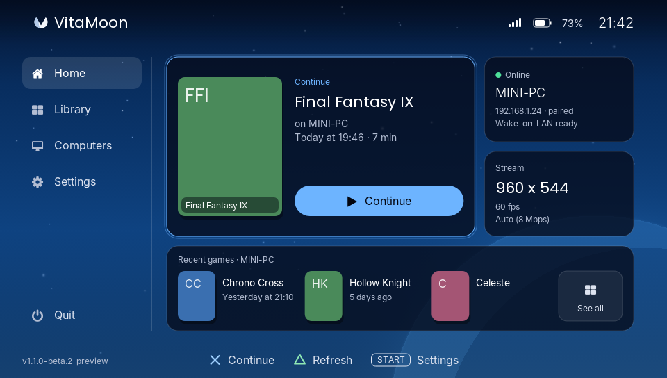
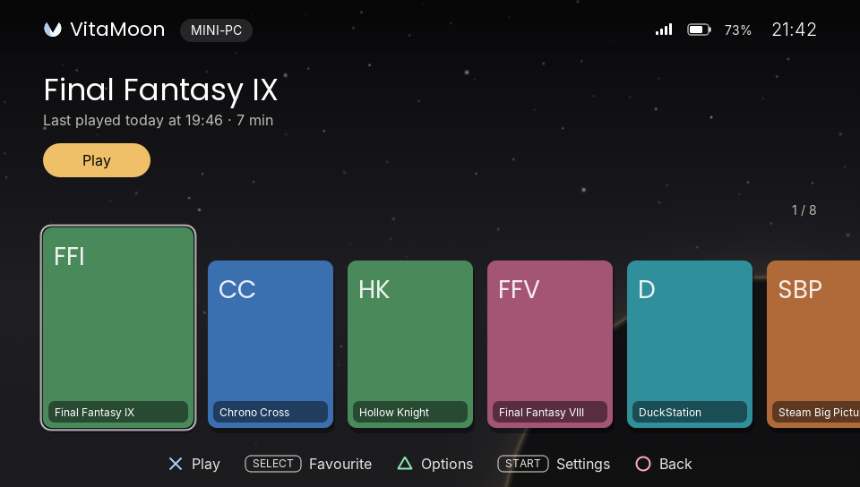
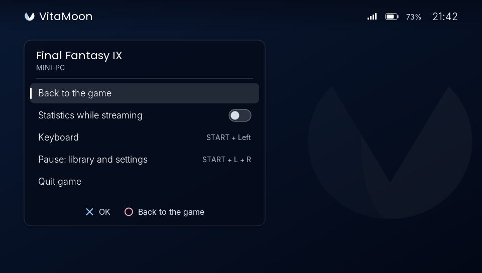
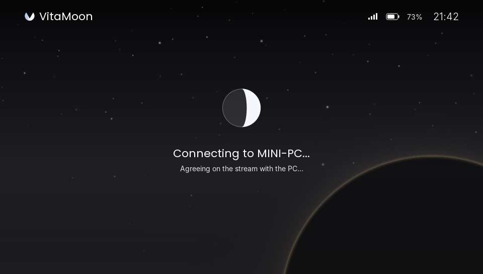
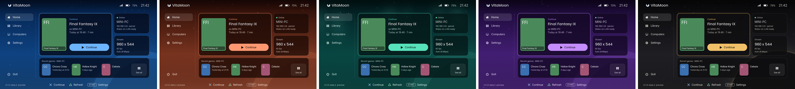

<div align="center">
  <picture>
    <source media="(prefers-color-scheme: dark)" srcset="docs/assets/vitamoon-logo-dark.svg">
    
  </picture>

  <h3>Moonlight game streaming for the PS Vita, built for a smooth picture over Wi-Fi</h3>

  [](../../actions)
  [](../../releases)
  [](#requirements)
  [](LICENSE)
</div>

---

VitaMoon is a [Moonlight](https://moonlight-stream.org) client for the PS Vita and PS TV: it plays the
games of a PC running [Sunshine](https://github.com/LizardByte/Sunshine) on the Vita, on your home
network.

It started from vita-moonlight 0.13.2 ([origins](#origins)) and reworks the streaming path (decoding
off the network thread, three display modes, adaptive audio, waiting for late Wi-Fi packets), the
interface, and the tools to measure what the Vita actually does. What was taken from other forks, and
what was measured by whom, is listed in [docs/design/performance.md](docs/design/performance.md). Up to
1.0.0-beta.1 it was called *Lune*.

> **Status: 1.0.0.** Measured on a Vita with Sunshine at 1280x720, 60 fps: 96 % of the frames the PC
> sends are shown, 97 ms median from a frame's arrival to the screen, no crash over 34 minutes. Known:
> short gaps in the sound (cause not found yet). On a PC, the menus are checked in three languages,
> every journey from opening a PC to the end of a game is replayed against an imitation of Sunshine,
> and the stream logic is covered by tests. See [the checkpoint report](docs/checkpoints/2026-11-17.md).
>
> **Testing: 1.1.0-beta.1.** Options to measure the decoder's delay, late frames, immediate display
> and 5 ms sound packets (*Settings > Tests (beta)*, all off by default), and a press-to-picture test
> from the quick menu. See [the tests of the 1.1 betas](docs/design/tests-1.1.md).

## Screenshots

<div align="center">
  
  
  
  
  
  
  
</div>

<sub>Rendered on a PC by `tools/ui-preview` with sample data (names, addresses and figures are not real
measurements).</sub>

## Features

- **Three display modes**, chosen through profiles: *Smooth* (one frame per screen refresh, drawn just
  in time), *Paced* (frames at the cadence the PC captured them, absorbing Wi-Fi jitter) and
  *Lowest latency* (newest frame at once); *Original* keeps the original code path for comparison.
- **Built for the Vita's Wi-Fi**: waits briefly for late or reordered packets instead of freezing the
  picture, decodes video and audio off the network thread, spreads the work over the three CPU cores,
  and warns when Wi-Fi power saving or Bluetooth is on.
- **Low-latency audio** with an adaptive buffer that grows only as much as the link needs.
- **Fast colour decoding**: the GPU converts the decoder's YUV output (about 2 ms less per frame,
  measured by juanjsebgarcia).
- **Statistics**: a one-line overlay during play (frame rate, receive-to-screen time, bitrate), and per
  session a CSV (one line per second) plus a summary with percentiles, to compare settings on your own
  setup.
- **Interface**: a home screen with a side menu and a preview of each page, its dashboard one press
  away from the game played last; computers with their state, a game library with cover art (favourites first, then
  the games last played, with when), two-pane settings with help for every option, pairing with a
  code to type in Sunshine, English, French and Spanish, five colour themes over a lunar sky (Night,
  Dawn, Aurora, Twilight, Eclipse) whose stars can twinkle and turn around the moon, titles in Poppins
  and text in Inter, a moon that fills at each step while a stream starts or reconnects.
- **In-game quick menu** (L + R + SELECT): statistics on or off, keyboard, the press-to-picture
  test, pause or quit the game, with the battery, its time left, the clock and the stream's length,
  without leaving the game.
- **Controls**: Xbox or PlayStation layout, rear touch, front touch as DS4 touchpad, mouse or tablet,
  motion controls, on-screen keyboard, button mapping files, PS button forwarding.
- Wake-on-LAN, restart of the stream from the pause menu when a setting needs it, quit-and-start
  when another game runs on the PC, typing as text whatever the PC's keyboard layout.
- **Log** on every run, with the main events and a health line per minute of play, written without
  slowing the stream.
- Automatic reconnection after a Wi-Fi drop or a sleep of the Vita, back into the same game.

## Requirements

- A PS Vita or PS TV that can install homebrew `.vpk` files (VitaShell).
- A PC running [Sunshine](https://github.com/LizardByte/Sunshine), on the same network as the Vita.
- For the best picture: a strong 2.4 GHz signal near the Vita, Wi-Fi power saving off on the Vita
  (*Settings > Power Save Settings*) and Bluetooth off if no Bluetooth device is used.

## Install

1. Download `vitamoon-v<version>.vpk` from the [latest release](../../releases), or
   `vitamoon-main.vpk` from [the latest development build](../../releases/tag/build-main).
2. Copy it to the Vita and install it with VitaShell.

VitaMoon has its own title ID (`VMOON0001`) and data folder (`ux0:data/vitamoon`): it installs next
to Moonlight without changing it, so both can be compared. A PC paired with Moonlight must be paired
again with VitaMoon.

**Coming from Lune 1.0.0-beta.1?** On its first start VitaMoon moves `ux0:data/lune` to
`ux0:data/vitamoon`: the paired PCs, the settings, the statistics and the logs follow. The old *Lune*
bubble can then be deleted.

## First-time setup

1. Start Sunshine on the PC.
2. On the Vita, choose **Search the network** (or **Enter an address**) and select the PC.
3. The Vita shows a 4-digit code and the address of Sunshine's web page
   (`https://<PC address>:47990`, **PIN** tab): type the code there. The Vita is listed in Sunshine
   under its own nickname.
4. Pick a game in the library and press ✕.

## Controls

| Input | Action |
|-------|--------|
| **START + L + R** | Pause the stream and go back to the menus (✕ on the game resumes it) |
| **START + Left** | On-screen keyboard |
| **L + R + SELECT** | In-game quick menu: back to the game, statistics, keyboard, delay test, pause, quit the game (the game keeps running; it gets no button while the menu is open) |
| **PS** (twice) | Back to the LiveArea; a single press is sent to the PC as the guide button (option) |
| Front touch | Mouse, DS4 touchpad or tablet (*Settings > Touch*), corner zones as extra buttons |
| Rear touch | Four zones acting as the extra shoulder and stick buttons (*Settings > Controls*, *Touch*) |

## Settings in short

*Settings > Performance > Profile* sets the options that change the stream the most:

| Profile | Display | Low-latency audio, decoder catch-up, fast colour decoding, core spreading | Wait for late packets |
|---|---|---|---|
| Smooth (default) | one frame per refresh, just in time | on | 20 ms |
| Paced | at the PC's capture cadence, plus a small margin | on | 20 ms |
| Lowest latency | newest frame at once | on | 20 ms |
| Original | the original code path | off | off |

The French user and test guide, with every option and the test plan, is in
[docs/GUIDE-FR.md](docs/GUIDE-FR.md).

## Getting help

- Each stream writes `ux0:data/vitamoon/stats/session-<date>.csv` and `.txt`: the files to attach to
  a bug report, with the build shown at the bottom left of the home screen.
- Every run writes its log, `ux0:data/vitamoon/logs/vitamoon-<date>.log` (the last 30 runs are
  kept): attach the one of the run with the problem. *Settings > General > Detailed log* adds every
  detail line.
- A crash leaves `ux0:data/psp2core-*.psp2dmp`; `tools/dev/crash-dump.sh` decodes it.
- Bugs and ideas: [Issues](../../issues).

## How it works

- [docs/design/architecture.md](docs/design/architecture.md): modules, threads and cores.
- [docs/design/streaming.md](docs/design/streaming.md): video, display modes, audio, network.
- [docs/design/performance.md](docs/design/performance.md): every performance change, its source and
  whether it was measured.
- [docs/design/forks.md](docs/design/forks.md): the other Vita Moonlight forks and what was taken.

## Building

```sh
export VITASDK=/usr/local/vitasdk        # with the packages listed in docs/BUILDING.md
cmake -S . -B build && cmake --build build -j
```

The VPK is `build/vitamoon.vpk`. Every push is built by GitHub Actions. Details, PC tests and the
interface preview: [docs/BUILDING.md](docs/BUILDING.md) and [docs/TESTING.md](docs/TESTING.md).

## Origins

VitaMoon is its own project. It started from **vita-moonlight 0.13.2**, the PS Vita port of
[Moonlight Embedded](https://github.com/moonlight-stream/moonlight-embedded) (Iwan Timmer) maintained
at [xyzz/vita-moonlight](https://github.com/xyzz/vita-moonlight), as released by AorsiniYT in November
2025 (commit `984603b`). That code is kept unchanged in the branch
[`legacy/vita-moonlight-0.13.2`](../../tree/legacy/vita-moonlight-0.13.2), and the history of both
projects is in the git log. Everything since is VitaMoon's (named *Lune* up to 1.0.0-beta.1):
[CHANGELOG.md](CHANGELOG.md) lists it, and [docs/design/forks.md](docs/design/forks.md) says what came
from the other Vita forks.

## Credits

- [xyzz/vita-moonlight](https://github.com/xyzz/vita-moonlight) and its contributors (the Vita port of
  [Moonlight Embedded](https://github.com/moonlight-stream/moonlight-embedded) by Iwan Timmer), with
  AorsiniYT's touch, pairing and host management work.
- [moonlight-common-c](https://github.com/moonlight-stream/moonlight-common-c) (streaming protocol) and
  [nanors](https://github.com/sleepybishop/nanors) (error correction).
- Performance work and measurements from
  [dubleyu/vita-moonlight-relay](https://github.com/dubleyu/vita-moonlight-relay) and
  [juanjsebgarcia/vita-moonlight](https://github.com/juanjsebgarcia/vita-moonlight); ideas from
  [VitaRPS5](https://github.com/mauricio-gg/vitaki-vitarps5),
  [alex4580/vita-moonlight](https://github.com/alex4580/vita-moonlight) and
  [NowaLone/vita-moonlight](https://github.com/NowaLone/vita-moonlight). Details in
  [docs/design/forks.md](docs/design/forks.md).
- Interface fonts Inter and Poppins (SIL Open Font License 1.1, `assets/LICENSE.Inter`,
  `assets/LICENSE.Poppins`), cut down to the characters VitaMoon can meet by `tools/art/make_fonts.py`;
  Nerd Fonts icons. The logo, the LiveArea images, the waiting moon and the GitHub preview are drawn by
  `tools/art/make_brand.py` (wordmark in Poppins), the menu backgrounds by `tools/make_background.py`.

Developed by [LouisF37](https://github.com/LouisF37) with the help of
[Claude Code](https://claude.com/claude-code).

## License

[GPL-3.0](LICENSE), like Moonlight Embedded and vita-moonlight.
